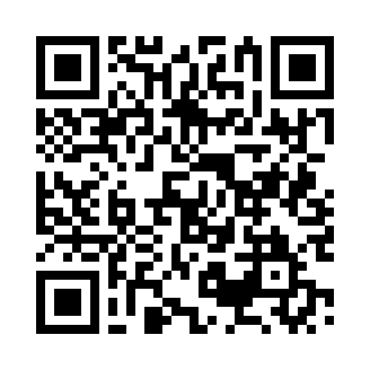

# Anhang F: Die Werkzeug-Quelle

Alle Vorlagen aus diesem Buch stehen als Text-Dateien im Internet,
zum Kopieren statt zum Abtippen. Die Adresse steht unter dem Bild,
der Bild-Code (QR) führt direkt dorthin.

**Die Adresse:** https://github.com/robotfreak/das-ki-buch-pflegende-vorlagen

**Was Sie dort finden:**

- **Anhang A**, die 36 Aufträge aus allen zwölf Kapiteln, sortiert nach Kapitel
- **Anhang B**, die Charta für das Pflege-Fenster als Vorlage zum Kopieren
- **Anhang C**, der Pflegemonat an der Pinnwand: die zwölf Zeilen für die Küche
- **Anhang D**, das Glossar: die Wörter dieses Buchs in Alltagssprache
- **Anhang E**, die Rechte-Synopse: die Lage in Deutschland, Österreich und der Schweiz

**So nutzen Sie es:** Die Datei öffnen, jeder Auftrag steht in einem
grauen Kasten mit Kopier-Knopf (das Kopier-Symbol oben rechts am
Kasten). Ein Klick, und der Wortlaut liegt in der Zwischenablage,
fertig zum Einfügen ins KI-Fenster. Die eckigen Klammern im Wortlaut
ersetzen Sie durch Ihre eigenen Angaben, zum Beispiel [Frage wörtlich
einsetzen] durch die Zeile aus Ihrem Brief.
